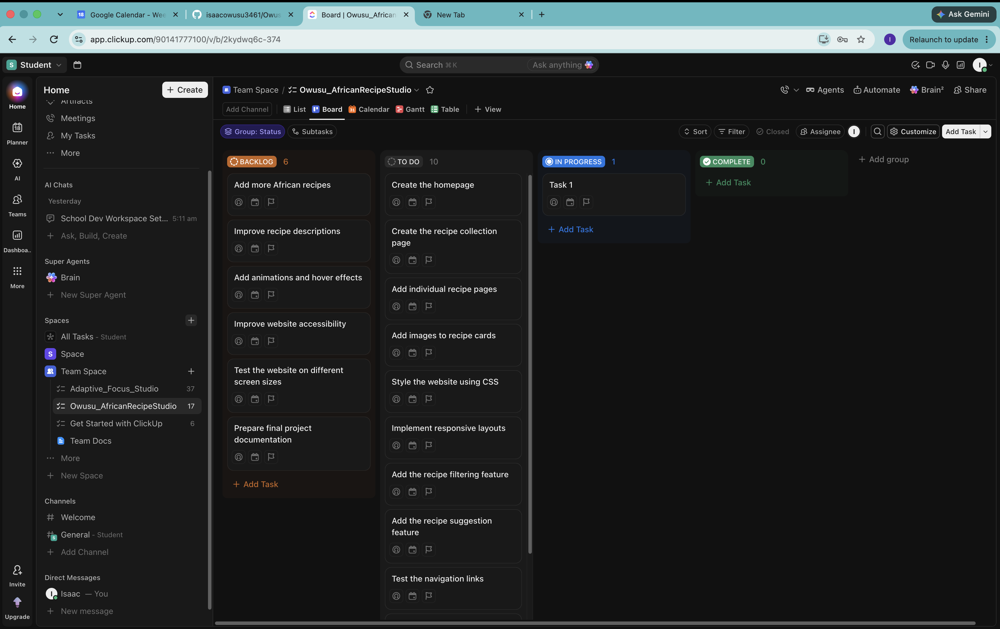
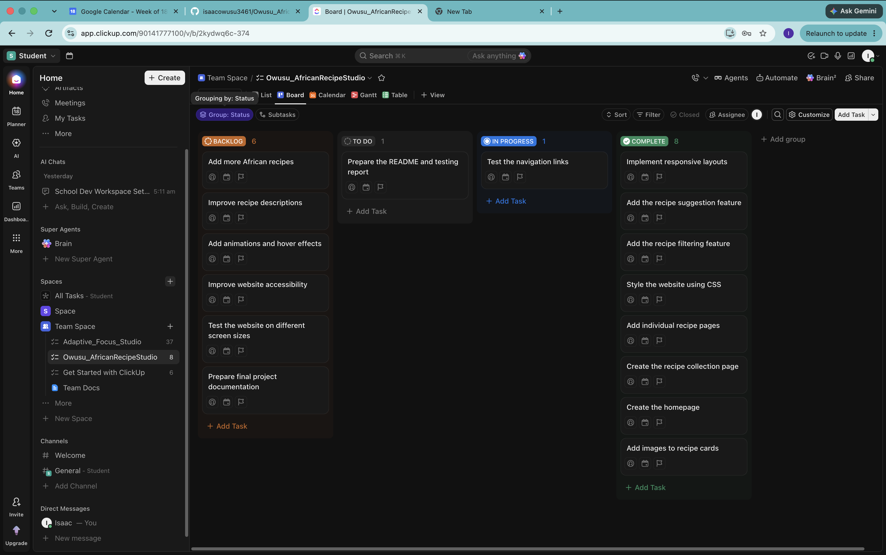

# African Recipe Studio - Development Journal

**Student:** Isaac Owusu  
**Course:** CSC 6370 Web Programming  
**Project:** African Recipe Studio

## 1. Project Overview

African Recipe Studio is a responsive recipe website developed using HTML and CSS. The website introduces users to different African dishes and provides ingredients and cooking instructions for each recipe. I developed the website in stages, starting with the basic HTML structure and gradually adding recipe content, styling, responsive layouts, interactive features, and accessibility improvements. I used Git and GitHub for version control and organized the project tasks using a Kanban workflow in ClickUp.

## 2. Project Management Using Kanban

I used Kanban to organize the development process and track the progress of different tasks. I created a ClickUp board with four columns: Backlog, To Do, In Progress, and Done. The Backlog contained tasks that I planned to complete later, while the To Do column contained tasks that were ready to be worked on. I moved tasks into In Progress when I started working on them and into Done after completing and checking them. This approach helped me break the project into smaller tasks and keep track of my progress.

### 2.1 Kanban Board Overview

The screenshot below shows the ClickUp Kanban board used to organize the project.

### 2.2 Backlog

The Backlog contained tasks that were planned but not yet ready to be implemented.

Some of the tasks included:

- Add more African recipes
- Improve recipe descriptions
- Add animations and hover effects
- Improve website accessibility
- Test the website on different screen sizes
- Prepare final project documentation

These tasks were moved to the To Do column when I was ready to work on them.

### 2.3 To Do

The To Do column contained tasks that were ready to be implemented.

Some of the tasks included:

- Create the homepage
- Create the recipe collection page
- Add individual recipe pages
- Add images to recipe cards
- Style the website using CSS
- Implement responsive layouts
- Add the recipe filtering feature
- Add the recipe suggestion feature
- Test the navigation links
- Prepare the README and testing report

I worked through these tasks during development and moved them to In Progress when I started implementing them.

### 2.4 In Progress and Done

The In Progress column showed the tasks I was actively working on. After implementing a feature and checking that it worked, I moved the task to Done. By the end of development, the completed tasks included the HTML pages, recipe collection, responsive CSS layout, interactive features, accessibility improvements, and final documentation.

## 3. Development Process

### Commit 1: Initial Project Setup

**Commit Message:** Initialed project setup and HTML structure

I started by creating the basic HTML pages for the website. These included the Home, Recipes, About, and Team pages.
I also added the navigation menu and used semantic HTML elements to organize the page structure.

### Commit 2: Recipe Collection

**Commit Message:** Added homepage content and African recipe collection

I added the homepage introduction, featured recipes, and recipe categories.
I also created the recipe collection with six African dishes and added JPG images for each recipe.

### Commit 3: Individual Recipe Pages

**Commit Message:** Added individual African recipe detail pages

I created a separate HTML page for each recipe.
Each page includes information about the dish, ingredients, cooking instructions, cooking time, and difficulty level.
I also added links from the recipe collection to the individual recipe pages.

### Commit 4: Main CSS Styling

**Commit Message:** Added main CSS styling and page layouts

I created the main CSS stylesheet and applied consistent colors, typography, spacing, and page layouts.
I used CSS Grid for the recipe cards and Flexbox for the navigation.

### Commit 5: Responsive Design

**Commit Message:** Made website responsive for different screen sizes

I added media queries to make the website work on desktop, tablet, and mobile screens.
The recipe grid changes from three columns on desktop to two columns on tablets and one column on mobile devices.

### Commit 6: Animations and Interactive Features

**Commit Message:** Added CSS animations and interactive recipe features

I added hover effects, transitions, and a fade-in animation to improve the appearance of the website.
I also implemented the Recipe Finder and Recipe Suggestion features using HTML radio buttons and CSS selectors.

### Commit 7: Accessibility Improvements

**Commit Message:** Improved accessibility and refine website design

I improved the website's accessibility by adding skip-to-content links, visible focus indicators, and current-page navigation highlighting.
I also improved the keyboard accessibility of the recipe filters and suggestions.

### Commit 8: Final Documentation and Testing

**Commit Message:** Completed project documentation and final website improvements

I completed the remaining accessibility updates on the individual recipe pages.
I also tested the website and prepared the README, testing report, and development journal.
During final testing, I noticed that the footer was not positioned correctly on pages with less content. I fixed this by adjusting the Flexbox layout in the stylesheet.

## 4. Challenges and Solutions

### Responsive Layout

One challenge was making the recipe cards display correctly on different screen sizes. I used CSS Grid and media queries to control the number of columns depending on the screen width.

### CSS-only Interactive Features

Another challenge was adding interactive features without JavaScript. I used HTML radio buttons and CSS selectors to show and hide recipe content based on the selected option. This allowed me to implement basic recipe suggestions and category filtering while keeping the website static.

### Relative File Paths

The individual recipe pages are stored in a separate folder, so I had to use relative paths to access the stylesheet, images, and other HTML pages. Using paths such as `../css/style.css` and `../images/jollof.jpg` allowed the nested pages to load the correct resources.

### Footer Positioning

During final testing, I noticed that the footer appeared too high on pages with less content. I updated the body layout to use Flexbox and allowed the main content area to expand. This fixed the footer positioning across the website.

## 5. Testing and Final Review

After completing the implementation, I tested the navigation links, recipe pages, images, responsive layouts, and interactive features. I also checked the accessibility features, including keyboard navigation, skip links, and visible focus indicators. The tests passed, and the website worked as expected. The complete testing results are documented in `testing.md`.

## 6. AI Assistance

I used ChatGPT to assist with reviewing and debugging HTML and CSS code. The Recipe Suggestion and Recipe Finder features are CSS-only simulations and do not use a real AI model.

## 7. Reflection

This project helped me improve my understanding of HTML and CSS, especially responsive design and organizing a website with multiple pages. I also gained more experience using CSS Grid, Flexbox, media queries, and CSS selectors to create interactive features without JavaScript. Using Git helped me track the changes made during development, while the Kanban board helped me organize tasks and monitor progress. In a nutshell, I was able to build a functional recipe website that works across different screen sizes and provides a simple way for users to explore African dishes.
